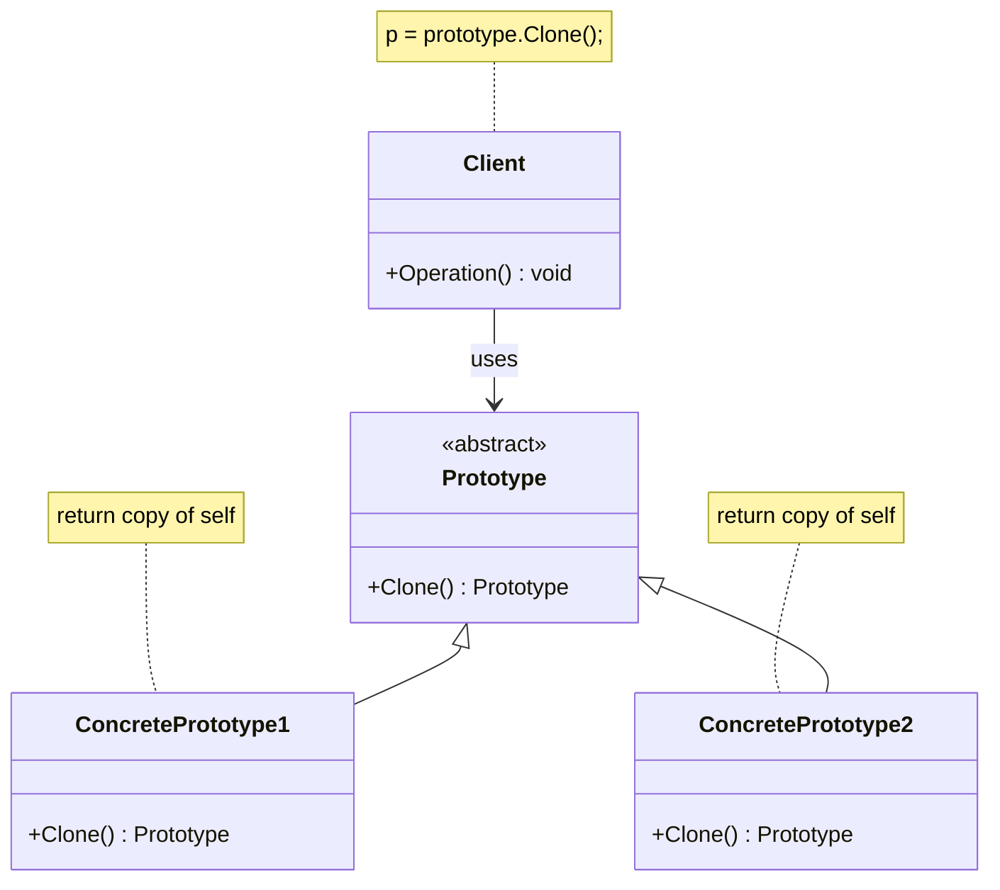

# Prototype Design Pattern

## Class Diagram

**Roles**

| Role | Responsibility |
|------|----------------|
| **Prototype** | Declares the `Clone()` contract. The client only knows this type. |
| **ConcretePrototype1 / 2** | Implement `Clone()` by returning a copy of themselves. |
| **Client** | Gets new objects by calling `prototype.Clone()` instead of `new`. |

---

## The Problem

Creating an object from scratch is sometimes a bad option:

- **Creation is expensive**: loading a 3D model, reading a file, querying a database, or running a heavy computation in the constructor. Repeating it for every new object wastes time.
- **The client has to know the concrete class**: to copy an object from outside, the client writes `if (e is Orc) new Orc() ... else if (e is Elf) new Elf() ...`. That couples the client to every subclass, and each new subclass breaks the copy code.
- **Outside code cannot copy private state**: a client cannot read private fields such as `_modelData`, so an external copy is always incomplete.
- **Naive copying shares references**: `c.Weapon = e.Weapon` makes both objects point to the same `Weapon`, so changing one changes the other.

## The Solution

Let **the object copy itself**.

1. Declare a `Clone()` method on the base type.
2. Each concrete class implements `Clone()`. Because the code lives inside the class, it can access private state and knows exactly how to copy its own fields.
3. The client holds a reference to the base type and calls `Clone()`. It never needs to know whether it is holding an `Orc` or an `Elf` (polymorphism does the work).
4. The expensive setup runs **once** for the original, and clones reuse its result.

> The client says "give me a copy of this", not "build me a new one like this".

---

## Shallow Copy vs Deep Copy

| | Shallow copy | Deep copy |
|---|---|---|
| Value types (`int`, `bool`) | Copied | Copied |
| Reference types (objects, lists) | **Only the reference is copied**, so both objects share the same inner object | **A new inner object is created** and its contents are copied |
| Effect | Changing the inner object through the copy also changes the original | Copy and original are fully independent |
| Typical C# tool | `MemberwiseClone()` | Manually clone each reference-type member |

**Rule of thumb:** if the object has mutable reference-type members (a `List`, another class), a shallow copy is usually a bug. Use a deep copy when the copy must be independent.

---

## When to Use It

- Creating an object is costly and you need many similar ones.
- You want a new object that starts from the **current state** of an existing one.
- You want to avoid parallel factory/subclass hierarchies or `if/switch` on concrete types.
- You want a **registry of ready-made prototypes** (named templates) that you clone on demand.

## Trade-offs

- Deep-copying objects with circular references or complex graphs can be tricky.
- Every class must implement `Clone()` correctly, and you must update it when you add fields.
- In .NET, avoid the built-in `ICloneable`: its contract does not say whether it is shallow or deep, so define your own interface or abstract method instead.