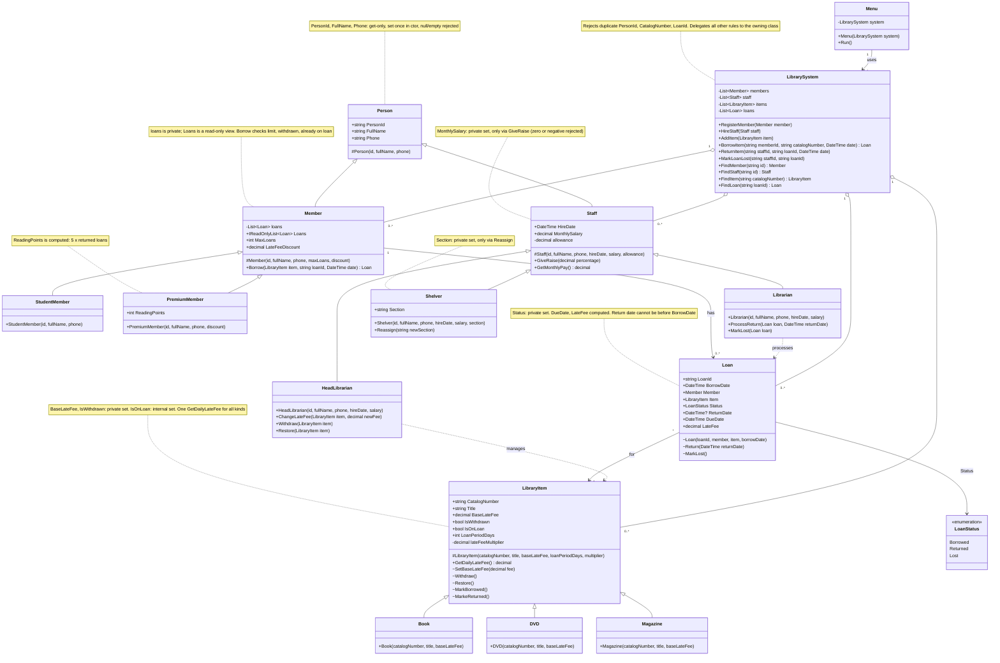

# Library System: Class Diagram

## Values each child passes up through `base(...)`

| Class | Values |
|---|---|
| StudentMember | maxLoans 3, discount 0 |
| PremiumMember | maxLoans 10, discount from constructor |
| Librarian / Shelver | allowance 0 |
| HeadLibrarian | allowance 400 |
| Book | loan period 21 days, fee multiplier 1 |
| DVD | loan period 7 days, fee multiplier 2 |
| Magazine | loan period 4 days, fee multiplier 0.5 |

