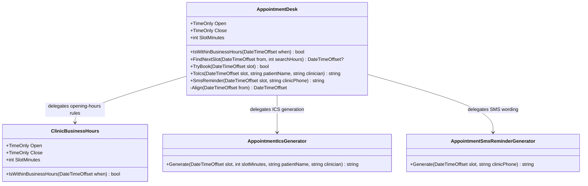

# Appointment Desk — UML

## Responsibilities

- **AppointmentDesk:** Tracks booked slots, finds the next available slot, books slots, and aligns times to the slot interval.
- **ClinicBusinessHours:** Decides whether a time falls on a working day and within the clinic's opening hours.
- **AppointmentIcsGenerator:** Produces the ICS calendar representation of an appointment.
- **AppointmentSmsReminderGenerator:** Produces the SMS reminder text for an appointment.

## SRP Refactoring

Scheduling (which slots are free and booked) is now separate from the clinic's opening-hours policy and from the two output formats. A change to working days, the calendar format, or the reminder wording touches only its own class, and `AppointmentDesk` stays focused on slot management.

The original `AppointmentDesk` methods remain available as delegating entry points, so existing callers do not change.