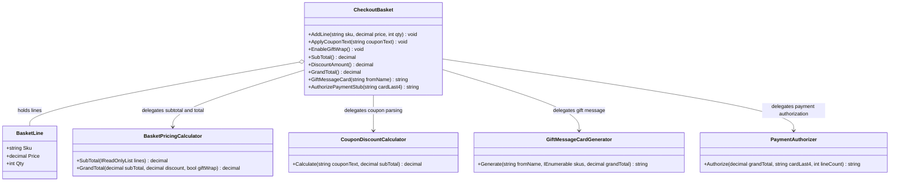

# Checkout Basket — UML

## Responsibilities

- **CheckoutBasket:** Holds the basket lines, the coupon text, and the gift-wrap choice, and validates added lines.
- **BasketLine:** Represents one SKU line with its price and quantity.
- **BasketPricingCalculator:** Calculates the subtotal and the grand total, including the gift-wrap fee.
- **CouponDiscountCalculator:** Interprets coupon text and returns the discount amount.
- **GiftMessageCardGenerator:** Produces the customer-facing gift message.
- **PaymentAuthorizer:** Produces the payment authorization code.

## SRP Refactoring

Basket contents are now separate from pricing, coupon rules, gift-message copy, and payment authorization. A change to a coupon format, the gift-wrap fee, the card wording, or the gateway touches only its own class, and `CheckoutBasket` stays focused on what is in the basket.

The original `CheckoutBasket` methods remain available as delegating entry points, so existing callers do not change.