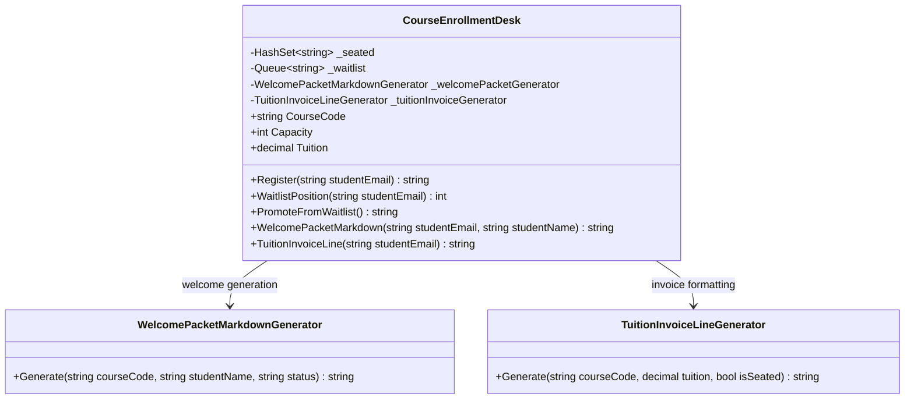

# Course Enrollment — UML

## Responsibilities

- **CourseEnrollmentDesk:** Maintains enrollment state, registers students, manages the waitlist, and promotes students.
- **WelcomePacketMarkdownGenerator:** Generates the welcome packet in Markdown.
- **TuitionInvoiceLineGenerator:** Formats tuition, VAT, and total amounts into an invoice line.

## SRP Refactoring

The enrollment class retains its core state and registration behavior. Changes to welcome packet formatting or invoice formatting can be made independently in their respective classes.

The original public methods remain available for compatibility with existing callers