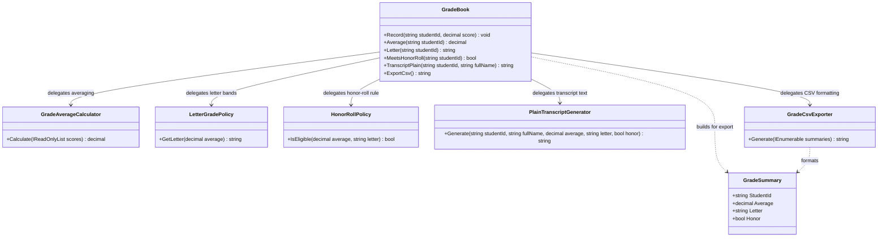

# Grade Book — UML

## Responsibilities

- **GradeBook:** Records and validates student scores and holds them per student.
- **GradeAverageCalculator:** Calculates a student's average from their scores.
- **LetterGradePolicy:** Maps an average to a letter grade.
- **HonorRollPolicy:** Decides whether a student qualifies for the honor roll.
- **PlainTranscriptGenerator:** Formats a student's transcript as plain text.
- **GradeCsvExporter:** Formats grade summaries as CSV rows ordered by student id.
- **GradeSummary:** Carries one student's average, letter, and honor result to the exporter.

## SRP Refactoring

Score storage is now separate from the averaging formula, the grading and honor-roll policies, and the two output formats. A change to the letter bands, the honor rule, the transcript layout, or the CSV structure touches only its own class, and `GradeBook` stays focused on recording scores.

The original `GradeBook` methods remain available as delegating entry points, so existing callers do not change.