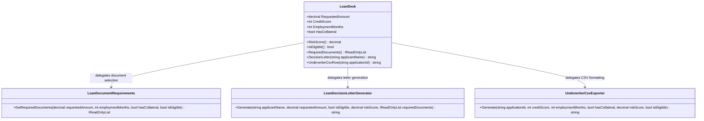

# Loan Desk — UML

## Responsibilities

- **LoanDesk:** Holds loan application data and determines risk score and eligibility.
- **LoanDocumentRequirements:** Determines which documents an applicant must provide.
- **LoanDecisionLetterGenerator:** Produces approval or rejection letters.
- **UnderwriterCsvExporter:** Formats application details for underwriter CSV output.

## SRP Refactoring

Loan eligibility decisions remain separate from document selection and output formatting. Each extracted class can evolve independently without taking responsibility for the entire loan workflow.

The original `LoanDesk` methods remain available as delegating entry points.