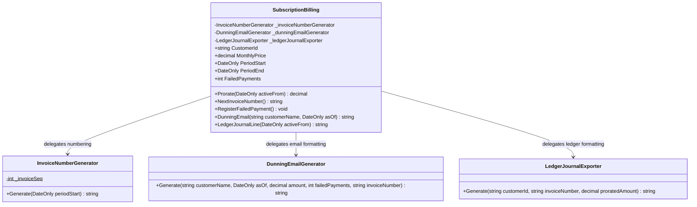

# Subscription Billing — UML

## Responsibilities

- **SubscriptionBilling:** Maintains subscription data, calculates prorated charges, and tracks failed payments.
- **InvoiceNumberGenerator:** Generates sequential invoice numbers. Its sequence is static and shared across instances of this generator.
- **DunningEmailGenerator:** Formats payment reminder emails based on failed-payment count.
- **LedgerJournalExporter:** Formats subscription transactions into ledger journal lines.

## SRP Refactoring

Billing calculations and subscription state remain in `SubscriptionBilling`. Number generation and output formatting are delegated to specialized classes.

The original public methods remain available, preserving the existing calling interface