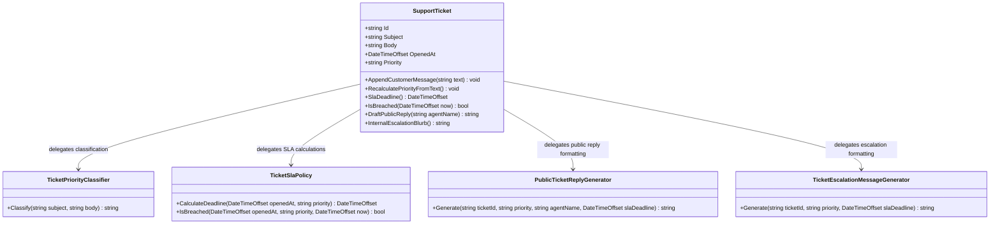

# Support Ticket — UML

## Responsibilities

- **SupportTicket:** Maintains ticket state, appends customer messages, and coordinates ticket operations.
- **TicketPriorityClassifier:** Classifies ticket priority as P1, P2, or P3 based on keywords.
- **TicketSlaPolicy:** Calculates SLA deadlines and checks whether they have been breached.
- **PublicTicketReplyGenerator:** Generates customer-facing replies.
- **TicketEscalationMessageGenerator:** Generates internal escalation messages.

## SRP Refactoring

Ticket state and coordination remain in `SupportTicket`. Each extracted class owns one supporting responsibility, allowing classification rules, SLA policies, and message formats to change independently.

The original public methods remain available and delegate to the appropriate helper classes.