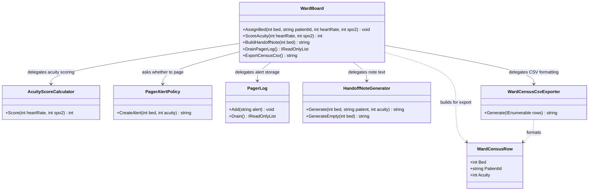

# Ward Board — UML

## Responsibilities

- **WardBoard:** Tracks which patient is in which bed, validates assignments, and keeps each bed's acuity score.
- **AcuityScoreCalculator:** Computes the clinical acuity score from heart rate and oxygen saturation.
- **PagerAlertPolicy:** Decides whether a score triggers a pager code and writes the alert text.
- **PagerLog:** Stores pager alerts and hands them out when drained.
- **HandoffNoteGenerator:** Writes the nurse handoff note for a bed.
- **WardCensusCsvExporter:** Formats the ward census as CSV rows ordered by bed.
- **WardCensusRow:** Carries one bed's patient and acuity to the exporter.

## SRP Refactoring

Bed tracking is now separate from clinical scoring, pager rules, alert storage, and the two output formats. A change to the clinical thresholds, the paging policy, the handoff wording, or the CSV layout touches only its own class, and `WardBoard` stays focused on who is in which bed.

The original `WardBoard` methods remain available as delegating entry points, so existing callers do not change.