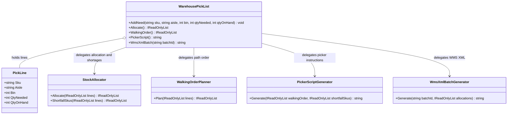

# Warehouse Pick List — UML

## Responsibilities

- **WarehousePickList:** Records the items that need to be picked and holds them as pick lines.
- **PickLine:** Represents one requested item with its aisle, bin, quantity needed, and quantity on hand.
- **StockAllocator:** Decides how much of each line can be allocated and which SKUs fall short.
- **WalkingOrderPlanner:** Orders the picks by aisle and bin and leaves out lines with nothing to pick.
- **PickerScriptGenerator:** Writes the step-by-step instructions and shortage warning for the picker.
- **WmsXmlBatchGenerator:** Builds the XML batch for the WMS integration.

## SRP Refactoring

Recording what needs picking is now separate from the allocation policy, the walking path, the picker's wording, and the WMS contract. A change to the allocation rules, the warehouse layout, the handheld instructions, or the XML format touches only its own class, and `WarehousePickList` stays focused on the list itself.

The original `WarehousePickList` methods remain available as delegating entry points, so existing callers do not change.